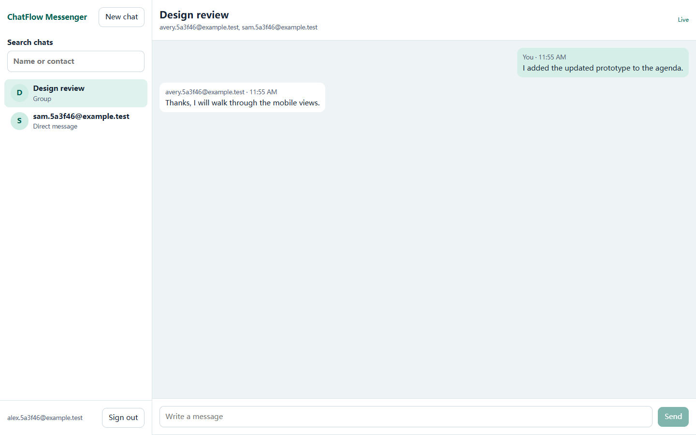

# ChatFlow

Two independent full-stack applications in one repository. Each ships its own React and TypeScript UI, FastAPI API, PostgreSQL migrations, Docker image and GitHub Actions workflow.

| Application | What it does | Local demo | Guide |
| --- | --- | --- | --- |
| ChatFlow Messenger | Direct messages, group chats, searchable contacts and conversations, message history, and authenticated WebSocket delivery | [Messenger](http://127.0.0.1:8081) | [Messenger README](apps/messenger/README.md) |
| ChatFlow AI | Multi-turn AI workspace with OpenAI or labeled Mock mode, SSE, model selection, budget limits, and conversation management | [AI Chat](http://127.0.0.1:8080) | [AI Chat README](apps/ai-chat/README.md) |

The links above open the local demos after startup. The repository's GitHub metadata does not list a public homepage or deployment URL.

## Run

Use Docker Engine with Compose v2. Run these commands at the repository root.

```sh
docker compose up --build messenger  # Messenger and its database
docker compose up --build api        # AI Chat and its database
docker compose up --build            # Both applications
```

Create synthetic accounts to try the apps. Messenger requires a second account to start a private chat. AI Chat starts in labeled Mock mode. Set the AI environment variables in its guide to enable OpenAI. Use `docker compose down` to stop the project and keep its data.

## Architecture

```text
apps/messenger/             React UI + FastAPI REST/WebSocket + Messenger migrations
apps/ai-chat/               React UI + FastAPI REST/SSE + generation worker + AI migrations
packages/shared/python/     Session authentication, request guards and validation
services/                   Deployment entry points
docs/messenger/             Messenger architecture and demo capture
docs/ai-chat/               AI architecture, baseline records and demo capture
```

Each application has a separate session cookie and PostgreSQL database. The AI Compose service retains the original `chatflow` project name, `api` and `db` service names, port 8080 and existing `chatflow_database` volume. Messenger uses `chatflow_messenger_database`. The original v1.1 baseline remains available on `feat/fullstack-rebuild`. See [verification](docs/verification.md) for the baseline and release results.

## Screenshots

### Messenger



### AI Chat


