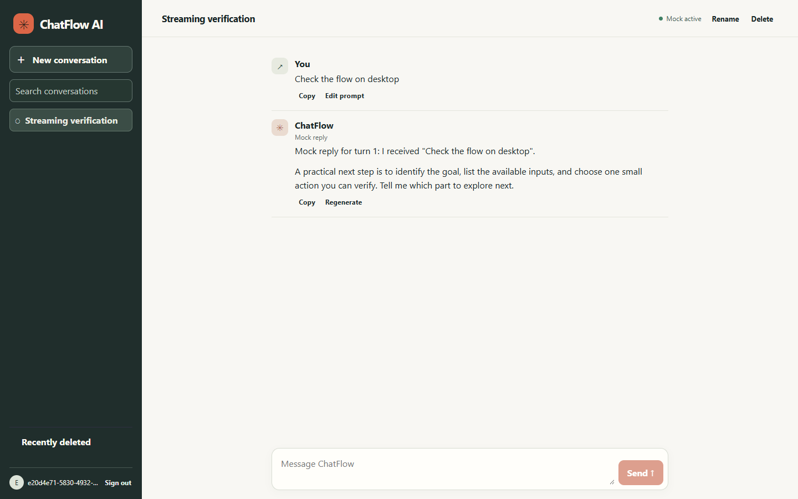

# ChatFlow — Full-Stack Messenger & AI Chat

A modern full-stack application featuring **ChatFlow Messenger** (real-time messaging with WebSocket) and **ChatFlow AI** (LLM-powered conversations with SSE streaming). Two independent applications, fully tested, production-ready, and deployed to public demonstrations.

## Overview

ChatFlow evolved from an early Chat Engine-based prototype into an independently implemented full-stack platform. The current implementation represents a complete architectural rebuild featuring modern patterns for real-time communication, AI integration, and responsive user interfaces.

Both applications share:
- **React + TypeScript** frontends with responsive design (desktop & mobile)
- **FastAPI** REST/WebSocket/SSE backends with comprehensive validation
- **PostgreSQL** databases with Alembic migrations
- **Docker** containerization with multi-stage builds
- **Automated testing** with Playwright end-to-end suites
- **GitHub Actions CI/CD** workflows for verification

## Project Evolution

| Version | Description | Status |
|---------|-------------|--------|
| **V1 (2023)** | Original Chat Engine-based prototype | Superseded; preserved in Git history ([`archive/chat-demo-v1`](https://github.com/hwen020/Chat-Demo/tree/archive/chat-demo-v1)) |
| **V2 (2026)** | Full-stack Messenger and AI Chat applications | Current; actively maintained |

## Live Demonstrations

> **Note:** Public demos use synthetic data and may take ~1 minute to start on first visit (Render Free tier sleeps after 15 minutes).

| Application | Demo URL | Technology |
|-------------|----------|------------|
| **Messenger** | https://hwen020-chatflow-messenger-demo-4olx.onrender.com | React + FastAPI + PostgreSQL + WebSocket |
| **AI Chat** | https://hwen020-chatflow-ai-demo-4olx.onrender.com | React + FastAPI + PostgreSQL + SSE (Mock mode) |

## Messenger

**Real-time messaging platform with group conversations and persistent history.**

### Features
- 🔐 Secure session-based authentication
- 💬 Private direct messages and group conversations
- 🔍 Full-text search over contacts and conversation history
- 📜 Paginated message history with cursor-based pagination
- ⚡ Real-time delivery via WebSocket
- 📊 Redis Pub/Sub for multi-instance coordination (local deployment)
- 🔗 Connection recovery and automatic reconnect
- 📱 Fully responsive design (desktop, tablet, mobile)

### Technical Stack
- **Frontend:** React 18.3, TypeScript, Vite
- **Backend:** FastAPI 0.133, uvicorn, WebSocket support
- **Database:** PostgreSQL 15+, Alembic migrations
- **Infrastructure:** Redis (local); single instance (public demo)
- **Testing:** Playwright end-to-end suite
- **Deployment:** Docker + Render/Neon (public); Docker Compose (local)

### Local Demo
```bash
docker compose up --build messenger
# Opens at http://127.0.0.1:8081
# Create two synthetic accounts to test private messaging
```

### Documentation
- [Architecture & Design](docs/messenger/architecture.md)
- [Acceptance & Verification](docs/messenger/acceptance.md)
- [Detailed README](apps/messenger/README.md)

---

## AI Chat

**Multi-turn conversational workspace with LLM integration and streaming responses.**

### Features
- 🤖 Multi-turn conversation management
- 🔀 Model selection (OpenAI or labeled Mock mode)
- 🌊 Server-sent events (SSE) with incremental response streaming
- ⏸️ Cancel mid-generation and retry synthesis
- ✏️ Edit prompts and regenerate responses
- 💾 Persistent conversation history
- 🗑️ Soft-delete and conversation restoration
- 💰 Budget limits and usage tracking
- 📱 Fully responsive design

### Technical Stack
- **Frontend:** React 18.3, TypeScript, Vite, react-markdown
- **Backend:** FastAPI 0.133, uvicorn, SSE streaming
- **Database:** PostgreSQL 15+, Alembic migrations
- **AI Integration:** OpenAI API adapter; Mock provider for public demo
- **Testing:** Playwright end-to-end suite
- **Deployment:** Docker + Render/Neon (public); Docker Compose (local)

### Public Demo Mode
> The public demonstration uses a labeled **Mock Provider** that generates synthetic responses. No OpenAI API key is required or exposed. The Mock provider is explicitly labeled in the UI.

### Local Demo
```bash
docker compose up --build api
# Opens at http://127.0.0.1:8080
# Starts in Mock mode; set environment variables to enable OpenAI
```

### Documentation
- [Architecture & Design](docs/ai-chat/architecture.md)
- [Acceptance & Verification](docs/ai-chat/acceptance.md)
- [Detailed README](apps/ai-chat/README.md)

---

## Repository Structure

```
ChatFlow/
├── apps/
│   ├── messenger/              # Messenger application
│   │   ├── web/               # React frontend (Vite)
│   │   ├── api/               # FastAPI backend
│   │   └── Dockerfile         # Multi-stage build
│   │
│   └── ai-chat/               # AI Chat application
│       ├── web/               # React frontend (Vite)
│       ├── api/               # FastAPI backend
│       └── Dockerfile         # Multi-stage build
│
├── packages/
│   └── shared/python/         # Shared authentication, schemas, validation
│
├── services/
│   ├── messenger/             # Nginx configuration, multi-instance tests
│   ├── public-demo.compose.yml # Public deployment simulation
│   └── render-start.sh        # Alembic + app startup script
│
├── docs/
│   ├── messenger/             # Architecture, acceptance evidence
│   ├── ai-chat/              # Architecture, acceptance evidence
│   ├── public-demo.md        # Deployment guide
│   ├── coverage-audit.md     # Technical verification matrix
│   └── verification.md       # Test results and evidence
│
└── render.yaml               # Render Blueprint for public deployment
```

---

## Getting Started

### Prerequisites
- Docker Engine with Compose v2 (or Podman)
- Node.js 20+ (for local frontend development)
- Python 3.12+ (for local backend development)
- PostgreSQL 15+ (or Docker will provide it)

### Local Deployment

**Run both applications together:**
```bash
docker compose up --build
# Messenger at http://127.0.0.1:8081
# AI Chat at http://127.0.0.1:8080
```

**Run individually:**
```bash
# Just Messenger
docker compose up --build messenger

# Just AI Chat
docker compose up --build api
```

### Configuration

**AI Chat — Enable OpenAI:**
```bash
export OPENAI_API_KEY=sk-...
export AI_OPENAI_MODELS='{"gpt-4o":[150000,600000]}'
docker compose up --build api
```

**Environment variables:** See `.env.example` in each app directory.

### Database Migrations

Alembic migrations run automatically on application startup. To migrate manually:
```bash
cd apps/messenger/api
alembic upgrade head

cd apps/ai-chat/api
alembic upgrade head
```

---

## Testing

### End-to-End Tests
```bash
# Messenger
cd apps/messenger/web
npm ci && npm run test

# AI Chat
cd apps/ai-chat/web
npm ci && npm run test
```

### Backend Tests
```bash
# Messenger API
cd apps/messenger/api
pip install -r requirements-test.txt
pytest

# AI Chat API
cd apps/ai-chat/api
pip install -r requirements-test.txt
pytest
```

### CI Pipeline
GitHub Actions runs automated tests on every push:
- Linting and type checking
- Unit and integration tests
- End-to-end browser automation
- Security and dependency audits

See [`.github/workflows/`](.github/workflows/) for active workflows.

---

## Technical Highlights

### Authentication & Security
- Session-based authentication with secure HttpOnly cookies
- Rate limiting on login, registration, and API endpoints
- Request body size limits and input validation
- CORS origin restrictions
- SQL parameter binding to prevent injection
- Demo mode explicitly hides metrics and API documentation

### Real-Time Communication (Messenger)
- WebSocket connection management with automatic reconnect
- Redis Pub/Sub for multi-instance message coordination (local)
- Single-instance deployment for public demo (simpler infrastructure)
- Full message history recovery on reconnect
- Proper cleanup of stale WebSocket connections

### Streaming Responses (AI Chat)
- Server-sent events (SSE) with incremental token delivery
- Generation worker thread for async processing
- Cancel and retry mid-generation without data loss
- Soft-delete with restoration capability
- Idempotent request keys to prevent duplicate processing

### Database Design
- Separate PostgreSQL databases for Messenger and AI Chat
- Alembic version control for schema migrations
- Connection pooling with pre-ping health checks
- Parameterized queries and proper index design
- Audit-ready soft-delete patterns

---

## Deployment

### Public Deployment (Render + Neon)
The `render.yaml` file defines automated deployment to [Render](https://render.com) with [Neon](https://neon.tech) PostgreSQL:
- Two independent Free-tier web services (one per app)
- Two isolated Free-tier Neon databases
- Automatic Alembic migrations on startup
- HTTPS/WSS with TLS certificate management
- Comprehensive health checks (`/healthz`, `/readyz`)

See [deployment guide](docs/public-demo.md) for details.

### Local Multi-Instance Testing
```bash
# Simulate public deployment locally
docker compose -f services/public-demo.compose.yml up --build
```

---

## Repository History

This repository retains the full Git history of its evolution:
- **Main branch** (`main`): Current ChatFlow V2 implementation
- **Archive branch** ([`archive/chat-demo-v1`](https://github.com/hwen020/Chat-Demo/tree/archive/chat-demo-v1)): Original Chat Engine prototype (2023)
- **Feature branches**: Historical development milestones

The older V1 implementation is preserved for historical reference but is no longer maintained. All active development occurs on `main`.

---

## Security & Privacy

✅ **Public demos use synthetic data only**
- No real user data stored
- Demo accounts use `@example.test` email domain
- Mock AI provider for public demonstration
- No sensitive credentials exposed in frontend or logs

✅ **Environment variables** (`DATABASE_URL`, `OPENAI_API_KEY`) are **server-side only**

✅ **Rate limiting** prevents abuse and resource exhaustion

✅ **Input validation** on all API endpoints

✅ **No unauthenticated access** to private conversations or history

For security reports, see the repository's Security Policy (or contact the maintainer privately).

---

## Screenshots

### Messenger — Group Chat


### AI Chat — Mock Provider Response


---

## Development & Contributing

This is a learning and portfolio project. The codebase demonstrates:
- Full-stack architecture with independent frontend/backend separation
- WebSocket and SSE streaming patterns
- PostgreSQL schema design and migrations
- End-to-end testing with Playwright
- CI/CD automation with GitHub Actions
- Docker containerization and multi-stage builds
- Python async patterns and thread coordination
- TypeScript and React best practices

For questions or feedback, open an issue or review the documentation above.

---

## License

[Specify your license here, e.g., MIT]

---

## See Also

- 📚 [Technical Coverage Audit](docs/coverage-audit.md) — Detailed verification matrix
- 🧪 [Test Results & Evidence](docs/verification.md) — Acceptance data
- 🏗️ [Deployment Guide](docs/public-demo.md) — Public infrastructure
- 📱 [Messenger Architecture](docs/messenger/architecture.md)
- 🤖 [AI Chat Architecture](docs/ai-chat/architecture.md)
