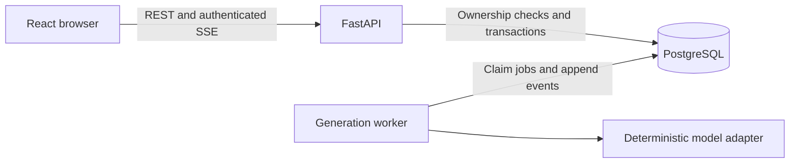

# Architecture

A submission commits a user message, an assistant placeholder and a queued generation in one transaction. The conversation row serializes submissions and allocates message sequence numbers. A unique idempotency key per conversation detects replays, and a partial unique index rejects overlapping runs. The worker claims queued jobs with PostgreSQL row locks and emits numbered events as it persists assistant text. Connection lifetime is independent from job lifetime.

Event cursors are generation-local integers. Completed events can replay for 15 minutes. After that clients reload durable message history. Running leases expire after 60 seconds. The worker marks abandoned jobs failed and never silently replays partial output. Session tokens are opaque and hashed. State-changing requests require the browser origin configured for the application. The database stores fixed-window quotas for authentication and submission.
