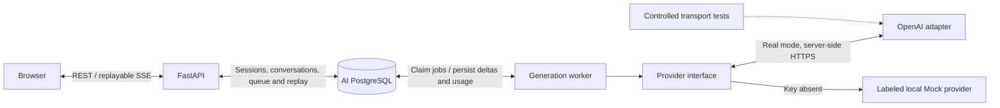

# AI Chat workspace architecture

**Stack** React, TypeScript, FastAPI, PostgreSQL, OpenAI Chat Completions, SSE, Docker Compose, pytest and Playwright.

## Context, streaming and errors

- The original [v1.1 architecture](architecture.md) stored conversations, jobs and replayable events in PostgreSQL. An owner check applies to history, generation status, cancellation, replay and restoration.
- A submission locks its conversation, checks its idempotency key and reserves the input and maximum output cost before queuing a generation. The worker reconstructs the bounded context from complete messages. Editing or regenerating marks the selected prompt and its descendants superseded and writes a new visible version. Historical rows remain stored.
- The provider interface yields text fragments and optional usage. Controlled transport tests exercise the OpenAI adapter and worker, while end-to-end browser tests exercise the labeled Mock provider. OpenAI requests run server-side with a configured model and output cap. The worker persists each delta for SSE replay. The worker checks cancellation and deadlines while awaiting upstream I/O and closes the upstream stream on cancellation.
- Upstream rate limits, rejected credentials, read timeouts, filtered replies and interrupted streams map to stable application error codes. Partial replies are saved and the user can retry. A real reply reports the provider's input and output counts, or displays **Token usage unavailable** when the usage chunk is absent. Mock replies are labeled separately.
- Assistant Markdown renders through React with raw HTML and remote images suppressed and URL sanitization enabled. The renderer highlights fenced code blocks.

## Upgrade and rollback

Migration `0002` adds fields with defaults and nullable metadata. Take a protected PostgreSQL backup and let active generations finish before replacing the application. Run `alembic upgrade head` with the new image before serving traffic. The upgrade preserves v1.1 message IDs, content, completion state and replay events. The existing AI Compose volume keeps its original name.

Before rolling back, stop new writers. If 0002-specific writes have occurred, downgrading removes deleted and superseded flags and may make previously hidden records visible. Restore a protected pre-upgrade backup in a separate database and reconcile newer writes before switching traffic. The automated test rehearses the upgrade and downgrade in an isolated synthetic schema. See the [AI Chat acceptance report](acceptance.md).

## English résumé descriptions

- Built a full-stack AI chat application with React, FastAPI, PostgreSQL, and resumable SSE, preserving multi-turn history and conversation ownership across schema upgrades.
- Implemented a server-side OpenAI provider adapter with context limits, cost admission, model selection, cancellation, and provider-reported token usage.
- Verified streaming, upstream errors, missing usage, and cancellation with controlled HTTP transport tests, and browser-tested prompt editing, retries, recovery, and safe Markdown rendering.
