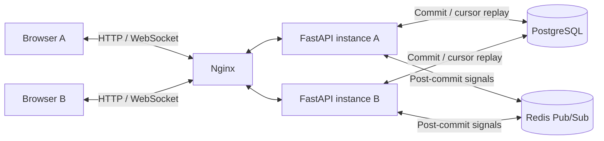

# Messenger architecture

**Stack** React, TypeScript, FastAPI, PostgreSQL, Redis Pub/Sub, Nginx, Docker Compose, pytest and Playwright.

## Ordering, durability and failure recovery

A sender can use the authenticated WebSocket or REST. The browser prefers WebSocket and falls back to the REST endpoint with the same request UUID if the socket or acknowledgment is unavailable. The server checks the session and membership, locks the chat row and commits the message and conversation timestamp together. PostgreSQL assigns the sequence. Serialization per chat aligns sequence order with commit order. The combination of chat, sender and request UUID makes retries idempotent.

Each API process has one Redis subscription. After commit, the writer signals its local sockets and queues a Redis notification with only the conversation UUID. A bounded background queue and a timeout keep Redis DNS and network delays off the acknowledgment path. The subscribing process re-reads committed rows from PostgreSQL. It can recover when a notification gets dropped, arrives twice, or reaches the node after a later notification.

Each connected socket checks PostgreSQL on a two-second interval as a fallback. Reconnecting clients ask for committed messages strictly after their cursor. The browser deduplicates by sequence and inserts by sequence, including optimistic acknowledgments and delayed frames. Session and membership checks run when opening the socket, reading a batch or sending a message.

Nginx forwards upgrade requests and balances two independently addressable API instances. Each instance reads the same Messenger database. Compose runs the Messenger migration once. The default proxy port is 8081. Direct instance ports only exist in the test override. The runtime posture and measured results are documented in the [Messenger acceptance report](acceptance.md).

## English résumé descriptions

- Built a distributed real-time chat application with React, TypeScript, FastAPI, PostgreSQL, Redis Pub/Sub, and Nginx load balancing across two API instances.
- Implemented commit-before-notify messaging with idempotent writes, authenticated WebSocket delivery, ordered client reconciliation, and cursor replay after disconnects.
- Automated cross-instance concurrency and fault-injection tests covering Redis interruption, API restart, authorization boundaries, and end-to-end delivery latency.
