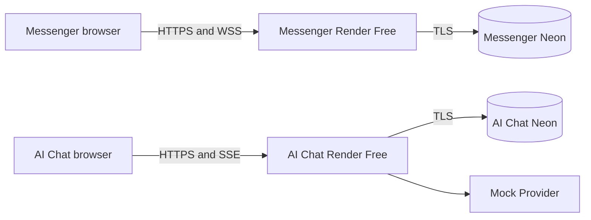

# Public demo deployment

## Current status

[Messenger](https://hwen020-chatflow-messenger-demo-4olx.onrender.com) and [AI Chat](https://hwen020-chatflow-ai-demo-4olx.onrender.com) are live as separate Render Free web services backed by separate Neon Free projects. Each app serves its UI and API from its own HTTPS origin. Local Compose and CI retain separate products and the full Messenger Nginx, Redis and two-instance topology.

| Product | Local and CI | Prepared public deployment |
| --- | --- | --- |
| Messenger | Nginx, Redis Pub/Sub, two FastAPI instances, PostgreSQL, WebSocket | One Render Free Docker web service serving its own React build and WSS, with its own Neon database |
| AI Chat | FastAPI, OpenAI adapter and labeled Mock mode, PostgreSQL and SSE | Another Render Free Docker web service serving its own React build and Mock SSE, with a different Neon database |

Each proposed public service serves its own UI and API on the same HTTPS origin. The UI derives the REST/SSE base from its origin and Messenger derives WSS from the same host. This preserves the existing host-only, HTTP-only session cookie. Separate Static Sites are pending validation of cross-origin authentication and stream transport. No wildcard CORS policy or cross-site bearer tokens are required by this candidate.

## Account activation

1. Sign in to Render and Neon and inspect the free quota. Match any existing demo-only services before importing the Blueprint. Keep existing unrelated services and databases in place.
2. Select or create **two isolated Neon Free databases** for synthetic demos in an available region. Use separate roles and credentials. Copy distinct TLS connection strings from the Neon dashboard directly to the corresponding Render secret fields.
3. In Render, select **New > Blueprint**, authorize the existing repository if prompted, then select branch `feat/chatflow-monorepo` and the root [render.yaml](../render.yaml). Verify that both resources display **Free**, each points to its own empty or demo-only database, and the selected workspace will not incur overage. Stop if card enrollment or paid resources are required.
4. Enter each `DATABASE_URL` in the Render secret prompt and apply. Each web service runs its own Alembic revision before starting. Record both assigned HTTPS URLs and check `/readyz`. The frontend and backend share an origin for each candidate service.
5. Hand back only the service URLs or an authorized connector session. Passwords and database URLs belong in the respective dashboards.

On Render, the backend uses its exact `RENDER_EXTERNAL_URL` as the mutation and WebSocket origin and requires secure cookies. On Neon connections the deployment config enforces TLS. The health endpoint is intentionally lightweight. `/readyz` additionally checks the database. [Render default environment](https://render.com/docs/environment-variables) and [Blueprint fields](https://render.com/docs/blueprint-spec).

## Public browser gate

Run the existing end-to-end suites from the respective web directories with `CHATFLOW_EXPECT_PUBLIC_DEMO=1`, pointing `MESSENGER_WEB` and `CHATFLOW_WEB` to the assigned HTTPS origins. Keep users isolated with unique `@example.test` registrations. There are no shared demo credentials. Use sample messages and prompts.

- Messenger desktop and 390px tests cover direct and group messages, search, reload, and ordering. On the live URLs also verify history pagination with 51 messages and an explicit socket disconnect or Render wake-up. Use three synthetic users to check nonmember isolation.
- AI Chat desktop and mobile tests cover visible Mock labeling, SSE increments and replay, cancellation, editing, regeneration, restoration, and reload. On the live URL check that a delta is visible before completion.
- Verify that Messenger exposes neither metrics nor API schemas in Demo mode. Both services hide interactive API docs. AI Chat forces Mock even if an OpenAI key is configured by mistake.
- Local public-mode testing can use `docker compose -p chatflow-public-check -f docker-compose.yml -f services/public-demo.compose.yml up --build -d messenger-api-a api` with `AI_PORT=18280`. Messenger listens on 18281. This is a local rehearsal and does not measure Render edge behavior.

## Free-tier limits

Render documents 750 Free web-service hours per workspace each calendar month, shared by both services and other Free web services. A service sleeps after 15 idle minutes and can take about a minute to wake. Bandwidth and build usage also count against workspace quotas. Outbound traffic-heavy use can lead to suspension. Confirm actual remaining quotas after login. [Render Free limits](https://render.com/docs/free)

Neon documents up to 100 Free projects, 100 CU-hours per project monthly, and 1 GB storage per project with a 20 GB aggregate limit. Idle compute scales to zero. Current account allowances must be checked after login. [Neon Free plan limits](https://neon.com/blog/10x-projects-on-free-plan) and [Neon scale-to-zero](https://neon.com/docs/introduction/scale-to-zero).
